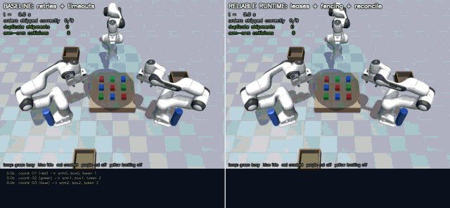
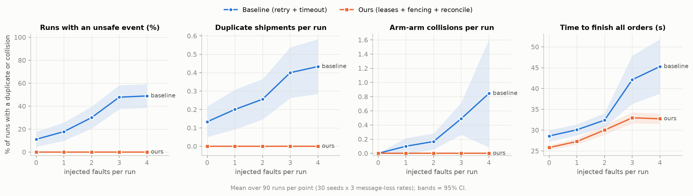
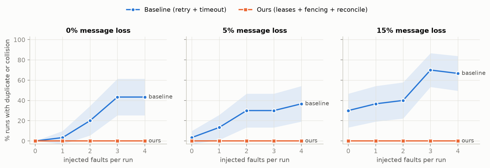
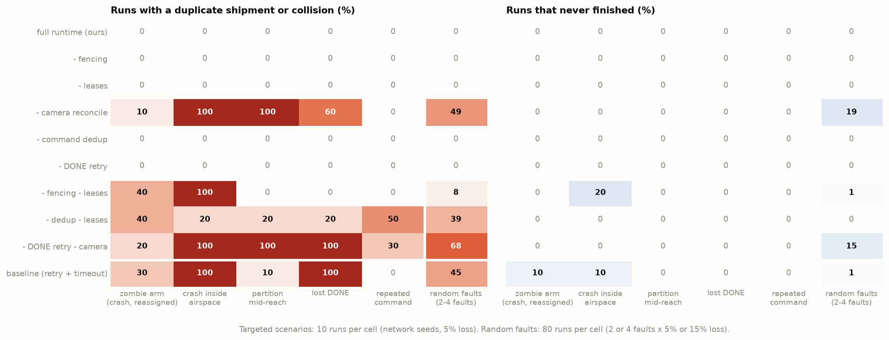
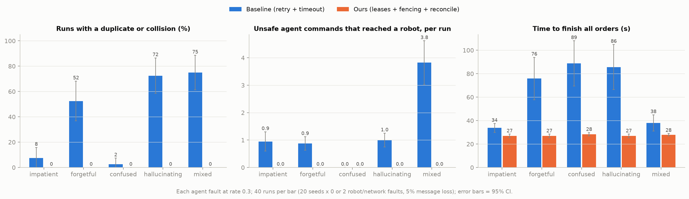
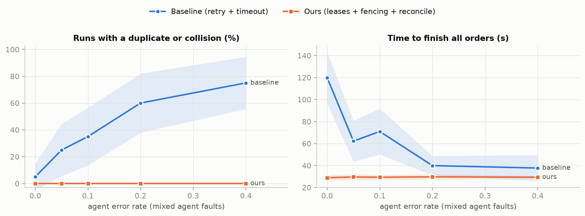

# 🦾 Reliable Agent Fleet: Exactly-Once Robot Actions Under Failure

**A fault-tolerant runtime that lets an AI planner coordinate a fleet of robot arms without shipping an order twice or crashing arms together, even when messages are lost, controllers crash, or the network splits.**

<p align="center">
  
  
  
  
  
  
</p>

Three real **Franka Panda** arms (MuJoCo Menagerie model) share one table of stock and fill customer orders. A planning agent (the coordinator) sends jobs over an unreliable network. A database can roll back a mistake, but a robot can't take back a box once it's in the bin. So the usual distributed-systems tools need rethinking when the action is physical. This project builds and tests a runtime that keeps every physical action safe under failure.

---

## 🎬 Demo

Same fleet, same orders, same three faults (lost acks, a controller crash mid-reach, a network partition). Left: standard retry + timeout stack. Right: Our runtime.



| | baseline | reliable runtime |
|---|---|---|
| orders shipped correctly | 8/9 | **9/9** |
| duplicate shipments | 1 | **0** |
| orders lost (out of stock) | 1 | **0** |
| arm-arm collisions | 2 | **0** |
| time to finish | 40.9 s | **36.8 s** |

The GIF plays at 2x speed. To make the full-speed video yourself, run `python record_demo.py`. 

## 🎯 The problem

When messages are lost, a controller crashes, or the network partitions, a standard "retry + timeout" stack:

- **ships orders twice**: a lost "done" makes the coordinator reassign a job that already happened.
- **loses orders**: the double shipments use up stock that later orders needed.
- **crashes arms into each other**: a timed-out lock is handed to a second arm while the first is still over the table.
- **runs zombie jobs**: a rebooted robot resumes a job that was already given to another arm.

## 📊 Key results at a glance

| Study | Runs | Baseline unsafe runs | Reliable runtime unsafe runs |
|---|---|---|---|
| Random robot and network faults | 900 | 140 of 450 (31 %) | **0 of 450** |
| Misbehaving AI planner (agent faults) | 600 | 84 of 200 at rate 0.3 | **0 of 200** |
| Ablations (one or two mechanisms removed) | 1,300 | up to 100 % per scenario | **0 %** for the full runtime |

The reliable runtime is also faster on average: **29.8 s vs 35.7 s** to finish all orders.

## ✨ How the runtime works

| Mechanism | Prevents |
|---|---|
| **Fencing tokens** on every job. Robots reject stale tokens, and a rebooted robot must re-validate (`HELLO`) before moving | zombie jobs, duplicate execution |
| **Leases** on jobs and on the shared table airspace, renewed by heartbeats. The robot checks its lease *on its own clock* before each physical commitment (entering the airspace, closing the gripper) and backs off if it can't prove ownership | two arms acting on the same job or in the same space during a partition |
| **Point of no return**: after the grasp the robot always finishes, and the coordinator never reassigns a job whose box is physically picked | half-done jobs, duplicate shipments |
| **Physical reconciliation**: when a lease lapses, the coordinator asks the cell camera (ground truth) whether the box was shipped, is in flight, or is untouched, before it retries. It reopens the airspace only when the camera shows it's clear | retries based on guesses |
| **Order-id deduplication** on the robot | duplicate commands |
| **DONE retry**: the robot repeats DONE in its heartbeats until the coordinator acknowledges it | orders that look "in progress" forever after a lost DONE |
| **Fine-grained airspace**: instead of one lock for the whole table, an arm reserves *one pick* (arm, box). Two picks may run at once only if an offline check (`fleet/zones.py`) proved that their whole paths stay at least 3 cm apart for *any* timing, using MuJoCo's collision detector on the real Panda meshes. The planner then picks, among boxes of the right colour, one compatible with what's already running | arms waiting on each other (throughput), without giving up collision safety |


## 🧰 What we used

| Component | Technology | Role in this project |
|---|---|---|
| Physics simulator | MuJoCo 4.0 | Simulates the three arms, the table, boxes and bins; detects collisions |
| Robot model | Franka Panda (MuJoCo Menagerie) | Real arm geometry and joint limits |
| Motion control | NumPy, damped-least-squares IK | Smooth Cartesian moves for each arm |
| Network and faults | Python (seeded) | Lossy messaging with latency, plus crash, partition and mute faults |
| Planner | LLM agent interface with one `assign` tool, tested with seeded simulated agents | Decides which arm fills which order |
| Experiments | Python `multiprocessing` | Resumable seeded sweeps over thousands of runs |
| Figures and video | Matplotlib, OpenCV | Result plots and the side-by-side demo |

## 📈 Results: 900-run fault-injection sweep

Every scenario is run once with each system, using the **same** random fault schedule and the same network randomness. The sweep covers 30 seeds × 0 to 4 random faults (crash, partition or mute, each triggered in a random motion phase) × 0, 5 or 15 % message loss, giving 450 runs per system.

| system | runs | unsafe runs* | duplicate shipments | collisions | orders correct (of 9) | unfinished runs | mean time (s) |
|---|---|---|---|---|---|---|---|
| baseline (retry + timeouts) | 450 | 140 (31 %) | 128 | 144 | 8.61 | 12 | 35.7 |
| **reliable runtime** (leases + fencing + reconcile) | 450 | **0 (0 %)** | **0** | **0** | **9.00** | **0** | **29.8** |

\*A run is unsafe if it has at least one duplicate shipment or arm-arm collision. Both systems use the same planner and the same fine-grained airspace scheduler. Only the failure handling differs.




What the sweep shows:

- **The reliable runtime is never unsafe**: zero duplicates and zero collisions in all 450 runs, under every fault count and loss rate. The baseline gets worse as faults increase, rising from 11 % to 49 % unsafe runs.
- **Message loss alone breaks the baseline.** Even with no injected faults, lost messages cause retries that ship a second box. The baseline is safe only on a perfect network with no faults.
- **Safety did not cost speed.** The reliable runtime finishes faster on average (29.8 s vs 35.7 s; 30.7 s vs 37.5 s in faulty runs), and the gap grows with the number of faults. The baseline wastes time on duplicate work and blind timeouts, while leases and the cell camera let the reliable runtime recover as soon as the evidence is in.

### From one airspace lock to per-pick reservations

The first version had one lock for the whole table, so the three arms mostly took turns, and each arm spent about 20 % of the run waiting. Per-pick reservations backed by the offline path-conflict table, plus faster moves, let compatible picks overlap:

| mean time to finish all orders | one airspace lock | per-pick reservations |
|---|---|---|
| no faults, no message loss | 35.5 s | **24.4 s** (-31 %) |
| reliable runtime, whole sweep | 42.3 s | **29.8 s** (-30 %) |
| baseline, whole sweep | 47.6 s | 35.7 s |

The reliable runtime had 0 unsafe runs out of 450 under both designs. The baseline gets a little safer too (55 % to 31 % unsafe runs), simply because each reservation is held for less time, so fewer timeouts fire. With a single airspace lock the demo above took 53.8 s.


## 🔬 Ablations: which mechanism prevents which failure?

Each variant switches off one mechanism, or a pair, and replaces it with the simpler behaviour it guards against: no tokens, fixed timeouts, blind redo, re-executing repeated commands, or a single DONE. Two tests are run against every variant:

- **Targeted scenarios**: one scripted fault per failure mode, 10 network seeds each.
- **Random faults**: 2 or 4 random faults at 5 % or 15 % message loss, 80 runs per variant.

1,300 runs in total.



What it shows:

- **The camera reconcile is the one essential mechanism.** Remove it alone and a crash or partition inside the airspace is unsafe in 100 % of runs, a lost DONE in 60 %, and random faults in 49 % (plus 19 % of runs that never finish). Nothing else can tell a box that is "in flight" from one that was never picked, or an arm frozen in the airspace from one that has left.
- **The other mechanisms come in redundant pairs (defence in depth).** Removing any one of them alone changed nothing in 130 runs each, because a partner covers the same failure:

  | failure | covered by | remove both |
  |---|---|---|
  | zombie arm (rebooted robot resumes a reassigned job) | fencing **or** robot-side lease check | 40 % unsafe |
  | crash inside the airspace | camera, **and** fencing or leases | 100 % unsafe |
  | repeated command (lost ACKs, re-sends) | dedup **or** leases (a robot can't act without a live lease) | 50 % unsafe |
  | lost DONE | DONE retry **or** camera ("box is in the bin") | 100 % unsafe |

  This is a design finding, not just a test result. Every pair is two *independent* lines of defence, so a bug in one mechanism doesn't become a physical accident unless its partner fails too.
- **Leases do the most quiet work.** "Dedup + leases" is the only pair that is unsafe in *every* column (20 to 50 %), because a live lease is what every robot checks before every physical commitment.

## 🤖 An LLM agent as the planner

`fleet/llm_planner.py` replaces the scripted assignment loop with an LLM agent that calls one tool, `assign(order, arm, reason)`. The interface is model-agnostic: any tool-calling model can fill this slot. The agent only **proposes**. What happens next depends on the runtime underneath:

- **baseline**: the tool call goes straight to the robot, as in most agent frameworks today.
- **reliable runtime**: the call is an *intent*, checked against the order ledger, leases and arm liveness. Unsafe intents are refused with a reason the agent can read. For example, re-assigning an order that is still running on another arm under a valid lease is refused: the runtime itself fences that arm, checks the camera, and hands the order back as PENDING only once it is safe to redo.

Both systems show the agent the same state view (orders, arms, stock, recent events). The simulation clock is frozen while the agent thinks. Every tool call is logged with the agent's stated reason and whether it was a *normal*, *repeat* or *unsafe re-do* intent (`results/*_decisions.jsonl`).

### Agent fault injection

To test the runtime against an unreliable planner, agent faults are injected the same way as robot and network faults. `fleet/fake_agent.py` plugs into exactly the slot a real model would use. It reads the same state text, plays a competent policy, and misbehaves on purpose in ways documented for LLM agents:

| agent fault | what it does |
|---|---|
| **impatient** | an order with no DONE for a while "looks stuck", so it re-assigns it to another arm. |
| **forgetful** | loses track and re-issues an earlier assignment, to the same arm or a different one |
| **confused** | sends an order to the wrong arm (one that is busy or crashed). |
| **hallucinating** | "re-does" an order that is already shipped, or invents an order id |
| **mixed** | all of the above. |


**Study A: each agent fault at rate 0.3** (40 runs per bar: 20 seeds × 0 or 2 robot/network faults, 5 % message loss):



| agent | unsafe commands issued (baseline / reliable) | ...that reached a robot | unsafe runs (baseline / reliable) |
|---|---|---|---|
| impatient | 38 / 4 | 38 / **0** | 3 / **0** of 40 |
| forgetful | 96 / 59 | 35 / **0** | 21 / **0** of 40 |
| confused | 0 / 0 | 0 / 0 | 1 / **0** of 40 |
| hallucinating | 155 / 61 | 40 / **0** | 29 / **0** of 40 |
| mixed | 242 / 167 | 153 / **0** | 30 / **0** of 40 |

The reliable runtime refused every unsafe command (291 of them), and every run shipped 9/9 orders with zero duplicates and zero collisions. The baseline's few "refusals" are only out-of-stock errors.

**Study B: dose-response.** The mixed agent at error rates from 0 to 0.4, with 2 robot faults:



The baseline's unsafe runs climb with the agent's error rate (1/20 to 15/20). The reliable runtime stays at **0/20 at every rate**, and its finishing time stays flat at about 29 s.

**The baseline makes the agent choose between safety and finishing.** At error rate 0 (a perfectly behaved agent) the baseline is *slow*, not fast, averaging 120 s. All 9 boxes physically ship, but a lost DONE leaves an order looking "in progress" forever, and an agent that never re-assigns waits for good. So the agent has two options: re-assign orders that look stuck and risk shipping twice (the right side of the curve), or don't re-assign and risk never finishing (the left side). The reliable runtime removes the choice: the robot repeats DONE until it's acknowledged, the camera settles anything still uncertain, and the agent gets both safety and progress.


## ⚠️ Limitations

What these results do **not** show, stated plainly:

1. **The camera is perfect.** Reconciliation reads ground truth from the simulator, with no missed detections, occlusion or delay. The ablations show it is the one mechanism nothing else replaces, so the safety result rests on a reliable sensor. How the protocol should behave when the camera is *uncertain* (most likely: wait rather than redo) is untested.
2. **The agents are simulated, not a real LLM.** The agent-fault study uses scripted misbehaviour at controlled rates. The planner interface for a real model is in place, but no real model was evaluated, so how often a real model issues unsafe commands is not measured.
3. **One small cell.** 3 arms, 9 boxes, 9 orders; scaling to more robots or contention is untested. The path-conflict table is computed for the boxes' nominal positions and relies on a 3 cm margin when boxes get nudged. That was verified empirically, not proven.
4. **Empirical, not formal.** Safety is shown over thousands of seeded runs, not proven. A model checker (e.g. TLA+) could prove the lease and fencing rules. The ablation's targeted scenarios use 10 runs per cell, and only selected pairs of mechanisms were removed (not all 32 combinations).

## 📁 Project structure

```text
Reliable_Agent_Fleet/
├── run_demo.py                  # Live 3D viewer (baseline or reliable)
├── record_demo.py               # Side-by-side demo video
├── experiments.py               # 900-run fault-injection sweep (resumable)
├── agent_experiments.py         # 600-run agent-fault study
├── ablation_experiments.py      # 1,300-run ablation study
├── plot_results.py              # Figures for the main sweep
├── plot_agents.py               # Figures for the agent study
├── plot_ablations.py            # Figures for the ablations
├── fleet/
│   ├── scene.py                 # Builds the cell: 3 Pandas (MjSpec), table, bins, boxes, airspace
│   ├── arm.py                   # Damped-least-squares IK and smooth moves (motor layer)
│   ├── world.py                 # Ground truth: grasping, shipments, collisions, camera queries
│   ├── net.py                   # Seeded lossy network and fault injector
│   ├── robot.py                 # Robot node state machine (baseline vs reliable)
│   ├── coordinator.py           # Planner + execution protocol (BaselineCoordinator vs ReliableCoordinator)
│   ├── zones.py                 # Offline path-conflict table for per-pick reservations
│   ├── llm_planner.py           # LLM planning agent (intents checked by the runtime)
│   ├── fake_agent.py            # Agent fault injection (impatient / forgetful / confused / hallucinating)
│   └── sim.py                   # Deterministic run loop and metrics
├── assets/                      # GIF and figures shown in this README
└── third_party/mujoco_menagerie # Franka Panda model (Apache-2.0)
```

## ⚙️ Setup and running

**Prerequisites:** Python 3.14 (tested with 3.14.4). Everything runs on CPU, and the Franka Panda model is already included in `third_party/`.

```bash
git clone https://github.com/md-jawad-117/Reliable_Agent_Fleet.git
cd Reliable_Agent_Fleet
pip install -r requirements.txt
```

### 👀 Watch the robots live

`run_demo.py` opens the interactive MuJoCo viewer and plays one full run in real time: three arms picking boxes and shipping orders while faults are injected (lost acks, a controller crash mid-reach, a network partition).

```bash
python run_demo.py --mode baseline              # standard retry + timeout stack: watch it ship twice and collide
python run_demo.py --mode reliable              # this runtime: same faults, every order shipped once
python run_demo.py --mode reliable --no-faults  # a clean run with no faults
python run_demo.py --mode baseline --speed 2    # play at 2x real time
```

- **Mouse:** left-drag to rotate, right-drag to pan, scroll to zoom.
- **On screen:** live counters for orders shipped, duplicate shipments and collisions, plus the active fault. A lamp behind each arm shows its state (green busy, blue idle, red crashed, purple cut off, yellow backing off, grey waiting). The shared airspace turns red on a collision.
- **In the terminal:** the event log (assignments, timeouts, refusals, camera checks).
- **On macOS**, the MuJoCo viewer must be started with `mjpython` instead of `python`.

To record the side-by-side comparison video instead (`media/demo_side_by_side.mp4`, no window needed):

```bash
python record_demo.py
```

### 🔁 Reproduce the results

Each script writes its data, figures and a summary table into `results/` (created on first run). Times were measured with 8 worker processes on a 22-thread desktop; use a smaller `--workers` on a laptop.

```bash
python experiments.py --seeds 30 --workers 8 && python plot_results.py     # main sweep, 900 runs, ~20 min
python agent_experiments.py --workers 8 && python plot_agents.py           # agent faults, 600 runs, ~15 min
python ablation_experiments.py --workers 8 && python plot_ablations.py     # ablations, 1,300 runs, ~25 min
python -m fleet.zones                                                      # rebuild the path-conflict table, ~30 s
```

For a quick check before the full sweep, `python experiments.py --pilot` runs a small subset.


